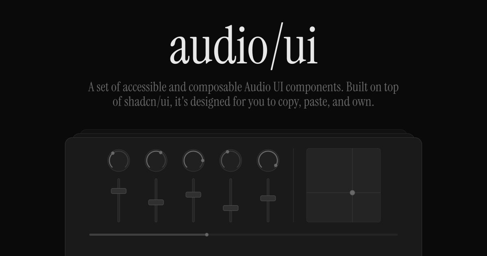

# audio/ui

Accessible, composable Audio UI components for the web, in React, Vue, Svelte or plain HTML: knobs, faders, meters, pads, waveforms, timelines, piano rolls and the synths, mixers and players made from them.

- **Primitives.** Headless, accessible parts with the behavior built in and the styling left to you, written once ([`@audio-ui/primitives`](packages/primitives), on the framework-agnostic [`@audio-ui/core`](packages/core)) and copied into your project for React, Vue, Svelte or the web.
- **Components you own.** A shadcn registry of styled components, blocks and hooks built on the primitives, copied into your project with the CLI.
- **Web Audio API first.** Meters, spectrum analyzers and tuners read real signals from `AnalyserNode`s, and live values move without re-rendering React.

Docs, demos and the catalog: **https://www.audio-ui.dev**

## Use it

```sh
# a headless primitive, for React (-vue, -svelte and -web for the others)
npx shadcn@latest add @audio-ui/knob-react

# a styled component, and what it needs, from the registry
npx shadcn@latest add @audio-ui/knob
```

See [Get started](https://www.audio-ui.dev/docs/get-started) for the registry setup.

For coding agents, four skills (`audio-ui`, `web-audio`, `design`, `core`) install as one Claude Code plugin, or with the open skills CLI:

```sh
/plugin install audio-ui --marketplace ouestlabs/audio-ui
npx skills add ouestlabs/audio-ui
```

## Develop

Bun workspaces and Turborepo; use `bun` and `bunx`, not `npm` or `npx`.

```sh
bun install
bun run dev    # the docs site on http://localhost:4000
```

| Path | What it is |
| --- | --- |
| `apps/www` | The docs site and the registry (TanStack Start, Fumadocs) |
| `apps/video` | Remotion videos of the real components |
| `packages/core` | `@audio-ui/core`, framework-agnostic logic |
| `packages/primitives` | `@audio-ui/primitives`, the behavior of each primitive, written once on the UI SDK kernel |
| `skills/` | The agent skills we ship to people using the library: `audio-ui`, `web-audio`, `design`, `core` |

Before opening a pull request:

```sh
bun run lint:fix
bun run build:pkg
```

The full list of checks, and how to add a component to the registry, are in [CONTRIBUTING.md](CONTRIBUTING.md). The words the code uses (Parameter, Commit, Primitive, Element) are in [CONTEXT.md](CONTEXT.md). Coding agents read [AGENTS.md](AGENTS.md).

## Resources

- [shadcn/ui registry](https://ui.shadcn.com/docs/registry)
- [Fumadocs](https://fumadocs.dev/)

## License

[MIT](LICENSE)
